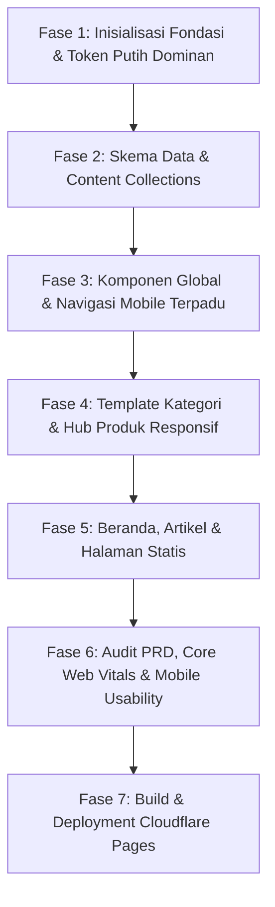

# WORKFLOW: Pengembangan & Rilis Portal CV. Serba Niaga Jaya

Alur kerja (workflow) terstruktur dari inisialisasi arsitektur hingga deployment produksi di Cloudflare Pages, memastikan kepatuhan mutlak terhadap PRD v3.0 (White-Dominant 85/10/5 & Mobile-First).

---

---

## Fase 1: Inisialisasi Fondasi Proyek
1. **Scaffold Astro Proyek**:
   - Inisialisasi Astro dengan TypeScript (`npm create astro@latest ./ -- --template minimal --typescript strict`).
   - Tambahkan integrasi Tailwind CSS (`npx astro add tailwind`).
2. **Setup Tipografi & Self-Hosted Fonts**:
   - Install `@fontsource/plus-jakarta-sans` dan `@fontsource/jetbrains-mono` untuk self-hosting font demi performa offline/koneksi lambat lapangan.
3. **Konfigurasi CSS Variables & Tailwind Theme (Proporsi 85 / 10 / 5)**:
   - Daftarkan token: Putih (`#FFFFFF`), Putih Hangat (`#FAFBF8`), Hijau Tua (`#14532D`), Hijau Utama (`#15803D`), Hijau Muda (`#ECF6EE`), Kuning Safety (`#FACC15`), Kuning Tua (`#CA8A04`), Kuning Muda (`#FEF9C3`), Tinta (`#0F1A13`), Garis Border (`#E4E8E0`).
   - Daftarkan timing & kurva bezier motion (`cubic-bezier(0.22, 1, 0.36, 1)`).

---

## Fase 2: Content Architecture & Collections
1. **Skema Zod Produk (`src/content/config.ts`)**:
   - Koleksi `products`: `id`, `name`, `category` (beton | baja | aspal | batuan), `gradeCodes` (array string), `unit`, `description`, `application`, `featuredImage`, `specSheet`.
2. **Skema Zod Artikel (`src/content/config.ts`)**:
   - Koleksi `articles`: `title`, `slug`, `category`, `publishedAt`, `readingTime`, `isDraftEducational`, `sniReference`, `summary`, `heroImage`.
3. **Data Produk & Draf Artikel Teknis**:
   - Seed data 4 kategori material utama dengan kode mutu standar (K-300, TS 420, AC-WC, Split 1/2).
   - Draf artikel rujukan Batch 1 (Precast U-Ditch vs Batu Kali, WF vs H-Beam, dll).

---

## Fase 3: Komponen Global & Navigasi Mobile Terpadu
1. **Header & Drawer Mobile**:
   - Desktop: Logo di kiri, menu dropdown mega-menu, tombol kuning WhatsApp di kanan.
   - Mobile: Logo + tombol hamburger menu yang membuka drawer navigasi bersih.
2. **Sticky Mobile Bottom Bar (Ergonomi Satu Tangan)**:
   - Bar putih 2 tombol (WhatsApp Kuning Safety & Email BoQ Berbingkai Hijau) yang otomatis sembunyi saat scroll turun dan muncul kembali saat scroll naik.
   - Tambahkan safe padding `pb-20` (80px) pada seluruh wrapper halaman.
3. **Komponen Primitif Desain**:
   - `Button.astro` (Utama: kuning dengan teks hijau tua, Sekunder: putih border hijau).
   - `SpecChip.astro` (Mono font, latar Hijau Muda, fitur salin spesifikasi & feedback).
   - `SpecTable.astro` (Header hijau muda, baris zebra putih hangat, scroll cue horizontal di mobile).
   - `Toast.astro` (Notifikasi putih border hijau di bagian bawah layar).
   - `Footer.astro` (Latar Putih Hangat `#FAFBF8`, garis atas hijau 2px, 4 kolom informasi).

---

## Fase 4: Template Halaman Kategori & Hub Produk
1. **Template Halaman Kategori (`src/pages/produk/[kategori].astro`)**:
   - Hero ringkas + chip nomenklatur utama.
   - Tabel Spesifikasi Cepat (responsif di layar HP dengan scroll cue).
   - Grid Varian Produk dengan tombol WhatsApp pre-filled PRD:
     `"Halo CV. Serba Niaga Jaya, saya ingin menanyakan ketersediaan dan penawaran harga untuk produk: [Nama Produk / Spesifikasi / Mutu]."`
   - Akordeon Panduan Memilih ("Kapan pakai apa").
   - Catatan Logistik & Armada (kapasitas ritase jujur tanpa statistik fiktif).
   - Banner Penutup Ganda (latar Hijau Muda).
2. **Hub Katalog (`src/pages/produk/index.astro`)**:
   - Sticky Tab Navigasi Kategori dengan scroll-spy dan garis aktif kuning.
   - Pencarian instan sisi klien (Fuse.js) berdasarkan nama & kode mutu.
   - Transisi kartu FLIP saat difilter.

---

## Fase 5: Beranda, Artikel & Halaman Pelengkap
1. **Beranda (`src/pages/index.astro`)**:
   - Hero Split 7/5 berlatar putih lapang dengan curtain reveal foto lapangan.
   - Bento Grid 4 Kategori (01–04) dengan nomor hijau dan chip mono.
   - 3 Tahapan Pemesanan Transparan (garis svg horizontal).
   - Wilayah Layanan (chip teks tanpa iframe peta).
2. **Detail Panduan Teknis (`src/pages/artikel/[slug].astro`)**:
   - Reading progress bar kuning 3px di bawah header.
   - Box Catatan Teknis Kuning Muda `#FEF9C3` bergaris kiri 4px kuning tua.
   - Sticky TOC di desktop, kotak nomor bab berangka tebal.
3. **Halaman Tentang (`/tentang`) & Kontak (`/kontak`)**:
   - Narasi profil usaha + 4 Pilar Misi bernomor editorial 01–04.
   - Akordeon Verifikasi Dokumen Legalitas (tanpa scan mentah).
   - Dua kartu kontak sejajar (WhatsApp & Email BoQ) + template pesan siap salin.
4. **Halaman Sistem (`404.astro`)**:
   - Ringkas, ramah, dan mengarahkan kembali ke katalog produk.

---

## Fase 6: Quality Assurance & Audit Kepatuhan PRD
Lakukan audit otomatis sebelum deployment:
- [ ] **PRD Hard Constraints Guard**:
  - `grep -r "<form" src/` (Harus 0 hasil).
  - `grep -r "iframe" src/` (Harus 0 hasil embed peta).
  - Pastikan tidak ada animasi count-up atau metrik buatan ("1000+ Proyek").
  - Pastikan tidak ada scan dokumen mentah.
- [ ] **Mobile Usability & Kontras Check**:
  - Uji di viewport HP Android (360px dan 390px) pada mode throttling 3G.
  - Verifikasi kontras tombol kuning `#FACC15` dengan teks `#14532D` (rasio ~8:1, WCAG AAA).
  - Uji tombol sticky bottom bar (sembunyi saat scroll turun, muncul saat scroll naik).
  - Pastikan `@media (prefers-reduced-motion: reduce)` berjalan sempurna.

---

## Fase 7: Build & Deployment Cloudflare Pages
1. Jalankan `npm run build` dan periksa ukuran bundel statis di folder `dist/`.
2. Deploy ke Cloudflare Pages (`wrangler pages deploy dist`).
3. Setup domain kustom dan aktifkan edge caching global.
